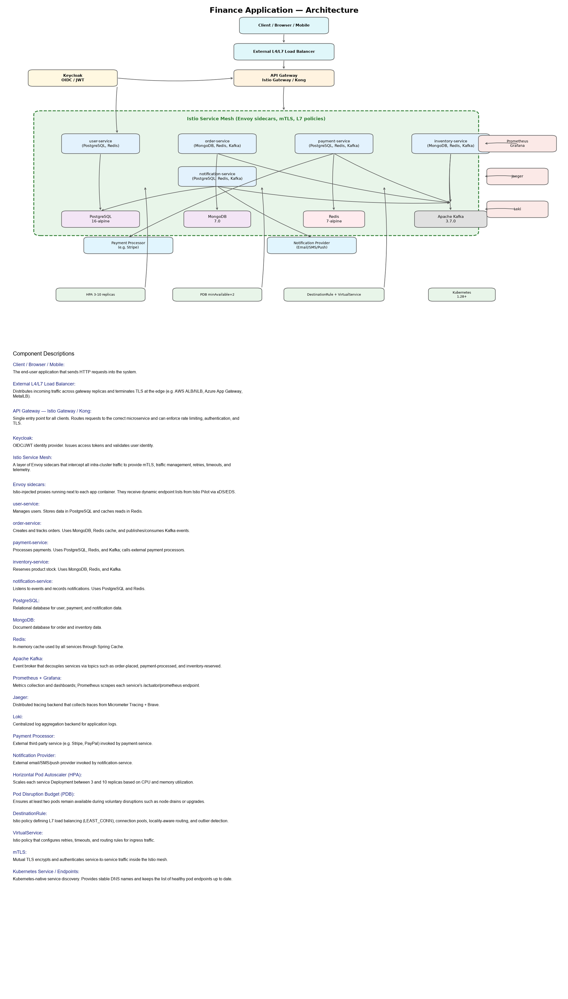
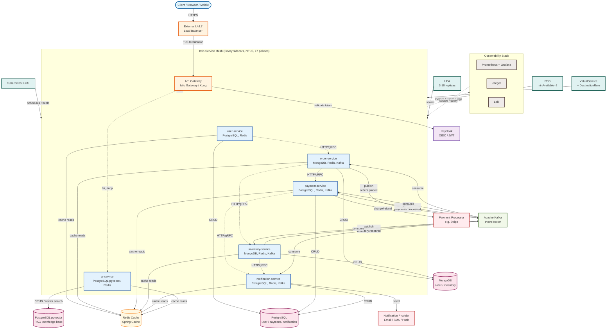

# Finance Application — Architecture

This document describes the overall architecture, request flow, component responsibilities, and deployment assumptions.

---

## 1. Goal

Build a production-style **Finance Application** as microservices based on the provided architecture diagram.

Key goals:

- Each service owns its own data.
- Services communicate asynchronously using events.
- Inter-service traffic is secured and observable via a service mesh.
- External traffic enters through a single API Gateway.
- Identity is centralized using OIDC/JWT.
- The whole system runs on Kubernetes.

---

## 2. Architecture Overview



> The static PNG above is a high-fidelity reference rendering. The Mermaid diagram below is the maintained, text-editable version that includes every component, connection, and platform support block.



---

## 3. Component Descriptions

A quick-reference description for every block shown in the architecture diagram.

### Client & Edge

- **Client / Browser / Mobile** – The end-user application that sends HTTP requests into the system.
- **External L4/L7 Load Balancer** – Distributes incoming traffic across gateway replicas and terminates TLS at the edge (e.g. AWS ALB/NLB, Azure App Gateway, MetalLB).
- **API Gateway — Istio Gateway / Kong** – Single entry point for all clients. Routes requests to the correct microservice and can enforce rate limiting, authentication, and TLS.

### Security

- **Keycloak** – OIDC/JWT identity provider. Issues access tokens and validates user identity.

### Service Mesh

- **Istio Service Mesh** – A layer of Envoy sidecars that intercept all intra-cluster traffic to provide mTLS, traffic management, retries, timeouts, and telemetry.
- **Envoy sidecars** – Istio-injected proxies running next to each app container. They receive dynamic endpoint lists from Istio Pilot via xDS/EDS.

### Business Services

- **user-service** – Manages users. Stores data in PostgreSQL and caches reads in Redis.
- **order-service** – Creates and tracks orders. Uses MongoDB, Redis cache, and publishes/consumes Kafka events.
- **payment-service** – Processes payments. Uses PostgreSQL, Redis, and Kafka; calls external payment processors.
- **inventory-service** – Reserves product stock. Uses MongoDB, Redis, and Kafka.
- **notification-service** – Listens to events and records notifications. Uses PostgreSQL and Redis.
- **ai-service** – Provides AI capabilities: fraud risk scoring, order summarization, RAG Q&A, document ingestion, and MCP tools. Uses PostgreSQL pgvector for the RAG knowledge base and Redis for response caching.

### Data & Caching

- **PostgreSQL** – Relational database for user, payment, and notification data.
- **MongoDB** – Document database for order and inventory data.
- **Redis** – In-memory cache used by all services through Spring Cache.

### Messaging

- **Apache Kafka** – Event broker that decouples services via topics such as `orders.placed`, `payments.processed`, and `inventory.reserved`.

### Observability

- **Prometheus + Grafana** – Metrics collection and dashboards. Prometheus scrapes each service’s `/actuator/prometheus` endpoint.
- **Jaeger** – Distributed tracing backend that collects traces from Micrometer Tracing + Brave.
- **Loki** – Centralized log aggregation backend for application logs.

### External Integrations

- **Payment Processor** – External third-party service (e.g. Stripe, PayPal) invoked by `payment-service`.
- **Notification Provider** – External email/SMS/push provider invoked by `notification-service`.

### Kubernetes Platform

- **Kubernetes 1.28+** – Container orchestration layer that schedules, heals, and scales workloads.
- **Horizontal Pod Autoscaler (HPA)** – Scales each service Deployment between 3 and 10 replicas based on CPU and memory utilization.
- **Pod Disruption Budget (PDB)** – Ensures at least two pods remain available during voluntary disruptions such as node drains or upgrades.
- **VirtualService + DestinationRule** – Istio policies that configure retries, timeouts, routing, and L7 load balancing.
- **mTLS** – Mutual TLS encrypts and authenticates service-to-service traffic inside the Istio mesh.
- **Kubernetes Service / Endpoints** – Kubernetes-native service discovery. Provides stable DNS names and keeps the list of healthy pod endpoints up to date.

---

## 4. High-Level Flow

1. Client calls an endpoint, e.g. `POST /orders`.
2. **API Gateway** validates the JWT with Keycloak.
3. Request enters the **Istio mesh**; mTLS and policies are applied.
4. Request reaches the target microservice.
5. Service performs business logic and uses its own database.
6. If needed, the service publishes an event to **Kafka**.
7. Other services consume the event and react independently.

### Example: Placing an Order

```text
Client
  │ POST /orders
  ▼
API Gateway (JWT validation)
  ▼
Istio mesh
  ▼
order-service
  stores order in MongoDB
  publishes OrderPlacedEvent
  ▼
Kafka
  ├─► payment-service ─ processes payment ─ publishes PaymentProcessedEvent
  ├─► inventory-service ─ reserves stock ─ publishes InventoryReservedEvent
  └─► notification-service ─ records notification
  ▲
order-service
  consumes PaymentProcessedEvent + InventoryReservedEvent
  updates order status
```

---

## 5. Component Matrix

| Layer | Component | Technology |
|---|---|---|
| Client | Web / Mobile | Any HTTP/REST client |
| API Gateway | Kong / Envoy | Kong Gateway (DB-less) or Istio Gateway (Envoy) |
| Identity | Keycloak | OIDC / JWT |
| Service Mesh | Istio + Envoy | mTLS, traffic management, policies |
| Orchestration | Kubernetes | Container scheduling, scaling, healing |
| Service | user-service | Spring Boot + PostgreSQL + Redis |
| Service | order-service | Spring Boot + MongoDB + Redis + Kafka |
| Service | payment-service | Spring Boot + PostgreSQL + Redis + Kafka |
| Service | inventory-service | Spring Boot + MongoDB + Redis + Kafka |
| Service | notification-service | Spring Boot + PostgreSQL + Redis + Kafka |
| Caching | Redis | Spring Cache abstraction with Redis backing |
| Messaging | Apache Kafka | Event streaming |
| Metrics | Prometheus + Grafana | Metrics and dashboards |
| Tracing | Jaeger | Distributed tracing |
| Logging | Loki + Logback | Centralized logs |

---

## 6. Microservice Responsibilities

### user-service
- Manage users: create and read.
- Database: PostgreSQL (`userdb`).
- Caches reads in Redis.

### order-service
- Create and track orders.
- Database: MongoDB (`orderdb`).
- Publishes `OrderPlacedEvent`.
- Consumes `PaymentProcessedEvent` and `InventoryReservedEvent`.

### payment-service
- Process payments for orders.
- Database: PostgreSQL (`paymentdb`).
- Consumes `OrderPlacedEvent`.
- Publishes `PaymentProcessedEvent`.

### inventory-service
- Reserve inventory for orders.
- Database: MongoDB (`inventorydb`).
- Consumes `OrderPlacedEvent`.
- Publishes `InventoryReservedEvent`.

### notification-service
- Listen to events and create notifications.
- Database: PostgreSQL (`notificationdb`).
- Consumes `OrderPlacedEvent`, `PaymentProcessedEvent`, and `InventoryReservedEvent`.

### ai-service
- Fraud risk scoring for transactions (`POST /ai/fraud-check`).
- Order summarization for customer notifications (`POST /ai/summarize-order`).
- RAG Q&A over ingested finance documents (`POST /ai/ask`).
- Document ingestion into the pgvector knowledge base (`POST /ai/ingest`).
- MCP server tool: `check_fraud_risk` exposed at `/mcp` for external agents.
- Database: PostgreSQL pgvector (`aidb`).
- Cache: Redis for LLM response caching (`ai-fraud`, `ai-summary`, `ai-ask`).
- AI provider switchable via Spring profiles (`kimi` for Moonshot/Kimi, `ollama` for local models, or `fallback` when no key is configured).

---

## 7. Caching

Spring Cache is backed by **Redis** and applied to frequently read entities:

| Service | Cache name | Cached lookups |
|---|---|---|
| user-service | `users` | `GET /users/{id}` |
| order-service | `orders` | `GET /orders/{id}` |
| inventory-service | `inventory` | `GET /inventory/{productId}` |
| payment-service | `payments` | `GET /payments/order/{orderId}` |
| notification-service | `notifications` | `GET /notifications/order/{orderId}` |

Writes (create / update / event-driven mutations) evict the relevant cache entries so stale data is not served.

---

## 8. Kafka Topics

| Topic | Producer | Consumers |
|---|---|---|
| `orders.placed` | order-service | payment-service, inventory-service, notification-service |
| `payments.processed` | payment-service | order-service, notification-service |
| `inventory.reserved` | inventory-service | order-service, notification-service |

> The Spring Boot configuration properties are hyphenated (`app.kafka.topic.order-placed`, `app.kafka.topic.payment-processed`, `app.kafka.topic.inventory-reserved`) but resolve to the dotted topic names shown above.

---

## 9. Security

- **Authentication**: Keycloak issues JWT tokens.
- **Token validation**: API Gateway and/or Istio validate the JWT.
- **Service-to-service security**: Istio mTLS encrypts traffic between pods.
- **Authorization policies**: Istio `AuthorizationPolicy` controls service access.
- **Secrets**: passwords and credentials stored in Kubernetes Secrets.

---

## 10. Observability

| Signal | Tool | How |
|---|---|---|
| Metrics | Prometheus + Grafana | Services expose `/actuator/prometheus`. |
| Traces | Jaeger | Micrometer Tracing propagates trace IDs. |
| Logs | Loki + Logback | Services emit structured logs. |
| Mesh telemetry | Istio | Automatic metrics, access logs, trace headers. |

---

## 11. Deployment Assumptions

- Target: local laptop with Docker, Kubernetes, and Istio installed.
- All components deployed via Kubernetes YAML manifests.
- Namespace: `finance` with Istio sidecar injection enabled.
- Each service is a separate Maven module.
- A `shared-common` Maven module contains events and DTOs.
- Databases: single PostgreSQL and single MongoDB instances with separate logical databases per service.
- Cache: single Redis instance shared by all services for Spring Cache-backed read-through caching.
- Kong and Envoy configs are both provided; Envoy via Istio Gateway is the default.
