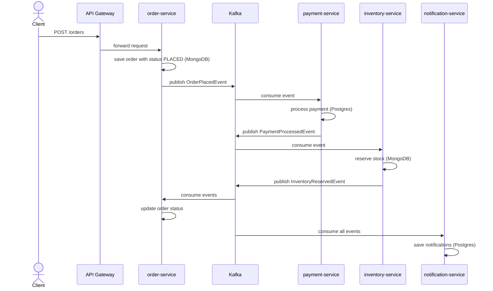

# Finance Application — Design

This document describes the domain model, API endpoints, event schemas, and database design.

---

## 1. Domain Model

### User
- `id` (UUID)
- `email`
- `firstName`
- `lastName`
- `createdAt`

### Order
- `id` (UUID)
- `userId`
- `items` (list of productId + quantity)
- `totalAmount`
- `status` (PLACED, PAYMENT_COMPLETED, INVENTORY_RESERVED, COMPLETED, FAILED)
- `createdAt`, `updatedAt`

### Payment
- `id` (UUID)
- `orderId`
- `amount`
- `status` (SUCCESS, FAILED)
- `transactionReference`
- `createdAt`

### InventoryItem
- `productId` (string, MongoDB id)
- `availableQuantity`
- `reservedQuantity`

### Notification
- `id` (UUID)
- `orderId`
- `eventType`
- `message`
- `createdAt`

---

## 2. API Endpoints

### user-service
| Method | Path | Description |
|---|---|---|
| POST | `/users` | Create a user |
| GET | `/users/{id}` | Get user by id |

### order-service
| Method | Path | Description |
|---|---|---|
| POST | `/orders` | Create an order |
| GET | `/orders/{id}` | Get order by id |
| GET | `/orders/user/{userId}` | List orders for a user |

### payment-service
| Method | Path | Description |
|---|---|---|
| GET | `/payments/order/{orderId}` | Get payment by order id |
| GET | `/payments` | List payments |

### inventory-service
| Method | Path | Description |
|---|---|---|
| POST | `/inventory` | Add stock for a product |
| GET | `/inventory` | List all inventory |
| GET | `/inventory/{productId}` | Get stock for product |

### notification-service
| Method | Path | Description |
|---|---|---|
| GET | `/notifications` | List all notifications |
| GET | `/notifications/order/{orderId}` | Get notifications for an order |

---

## 3. Event Schemas

All events are JSON and live in the `shared-common` module.

### OrderPlacedEvent
```json
{
  "eventId": "uuid",
  "orderId": "uuid",
  "userId": "uuid",
  "items": [
    { "productId": "uuid", "quantity": 2 }
  ],
  "totalAmount": 199.99,
  "occurredAt": "2026-10-27T10:00:00Z"
}
```

### PaymentProcessedEvent
```json
{
  "eventId": "uuid",
  "orderId": "uuid",
  "status": "SUCCESS",
  "amount": 199.99,
  "transactionReference": "TXN-123",
  "occurredAt": "2026-10-27T10:00:01Z"
}
```

### InventoryReservedEvent
```json
{
  "eventId": "uuid",
  "orderId": "uuid",
  "productId": "uuid",
  "quantityReserved": 2,
  "status": "RESERVED",
  "occurredAt": "2026-10-27T10:00:02Z"
}
```

### Notifications

The notification service does **not** define a separate `NotificationEvent`. Instead it consumes `OrderPlacedEvent`, `PaymentProcessedEvent`, and `InventoryReservedEvent` and persists a `Notification` record for each.

---

## 4. Database Schemas

### PostgreSQL — userdb, paymentdb, notificationdb

**users table**
```sql
CREATE TABLE users (
  id UUID PRIMARY KEY,
  email VARCHAR(255) NOT NULL,
  first_name VARCHAR(255),
  last_name VARCHAR(255),
  created_at TIMESTAMP NOT NULL
);
```

**payments table**
```sql
CREATE TABLE payments (
  id UUID PRIMARY KEY,
  order_id UUID NOT NULL,
  amount DECIMAL(10,2) NOT NULL,
  status VARCHAR(50) NOT NULL,
  transaction_reference VARCHAR(255),
  created_at TIMESTAMP NOT NULL
);
```

**notifications table**
```sql
CREATE TABLE notifications (
  id UUID PRIMARY KEY,
  order_id UUID NOT NULL,
  event_type VARCHAR(100) NOT NULL,
  message TEXT,
  created_at TIMESTAMP NOT NULL
);
```

### MongoDB — orderdb, inventorydb

**orders collection**
```json
{
  "_id": "uuid",
  "userId": "uuid",
  "items": [{ "productId": "PROD-1", "quantity": 2 }],
  "totalAmount": 199.99,
  "status": "PLACED",
  "createdAt": "2026-10-27T10:00:00Z",
  "updatedAt": "2026-10-27T10:00:00Z"
}
```

**inventory collection**
```json
{
  "_id": "PROD-1",
  "availableQuantity": 100,
  "reservedQuantity": 0
}
```

---

## 5. Sequence Diagram: Place Order


